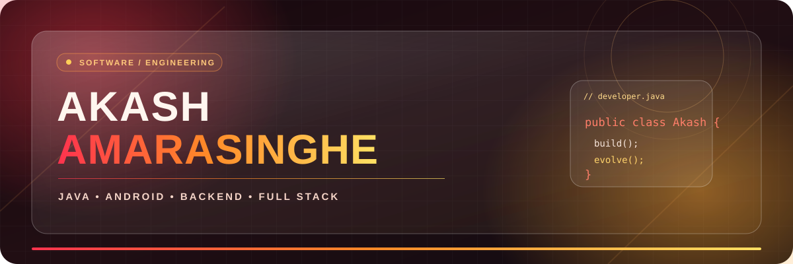
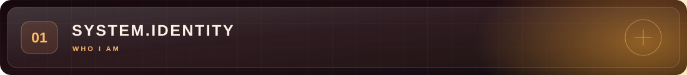
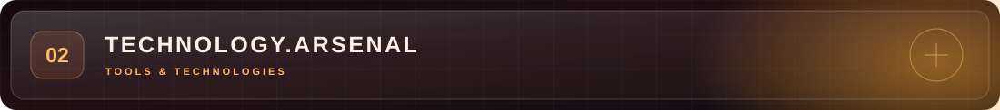
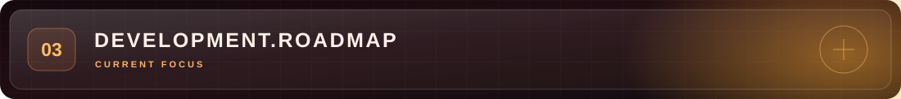
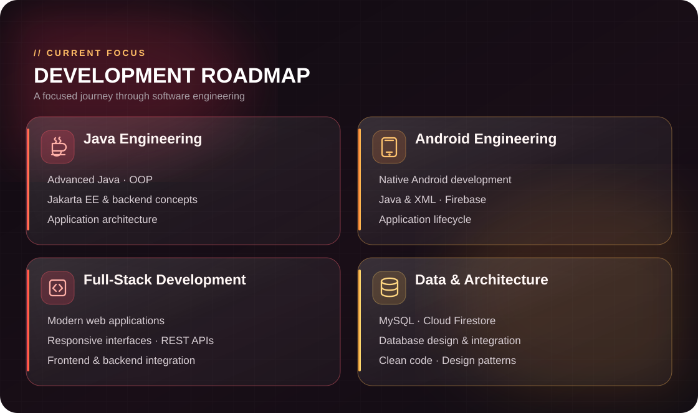
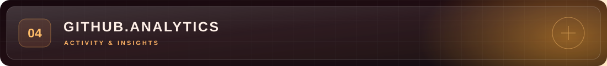
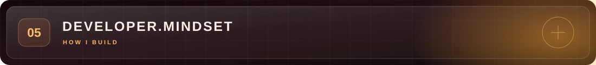
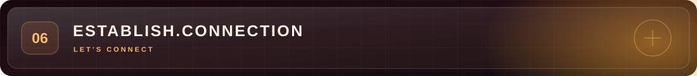
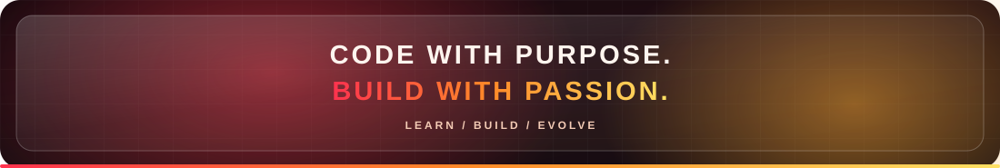

<div align="center">



<br />


<br />


<br /><br />


</div>

<br />

<div align="center"></div>

<br />

<table>
<tr>
<td valign="top" width="56%">

### ⚡ About me

I'm **Akash Amarasinghe**, a **Software Engineering Undergraduate** passionate about creating practical, reliable software and turning ideas into working applications.

**Java engineering** is my primary focus. I also enjoy native Android development, backend technologies, full-stack applications, and database-driven systems.

**Exploring and improving**

- ☕ Advanced Java, OOP & backend systems
- 📱 Native Android development
- 🌐 Frontend and backend integration
- 🗄️ Database design & integration
- 🧠 Architecture, design patterns & clean code

</td>
<td valign="top" width="44%">

### `Developer.java`

```java
public class Akash {
    String name = "Akash Amarasinghe";
    String focus = "Java Engineering";

    String[] interests = {
        "Android", "Backend",
        "Full-Stack", "Databases"
    };

    void mission() {
        System.out.println(
            "Learn. Build. Evolve."
        );
    }
}
```

</td>
</tr>
</table>

<br />

<div align="center"></div>

<div align="center">

#### `01 / PROGRAMMING LANGUAGES`


#### `02 / MOBILE & APPLICATION DEVELOPMENT`


#### `03 / DATABASE & BACKEND`


<br />


#### `04 / DEVELOPMENT ENVIRONMENT`


</div>

<br />

<div align="center"></div>

<br />

<div align="center">



</div>

<br />

<div align="center"></div>

<br />

<div align="center">


<br /><br />


<br /><br />


</div>

<br />

<div align="center"></div>

<br />

<div align="center">


### *“Great software is built one meaningful line of code at a time.”*

Stay curious. Stay consistent. Keep creating.

</div>

<br />

<div align="center"></div>

<br />

<div align="center">

**Let's connect, share knowledge, and build something meaningful.**

<br />

<a href="https://github.com/AkashAmarasinghe"></a>
<!-- Replace these placeholders with your actual links before publishing. -->
<a href="YOUR_LINKEDIN_URL"></a>
<a href="mailto:YOUR_EMAIL@gmail.com"></a>

<br /><br />



<sub>DESIGNED BY AKASH AMARASINGHE · POWERED BY CURIOSITY & COFFEE ☕</sub>

</div>
